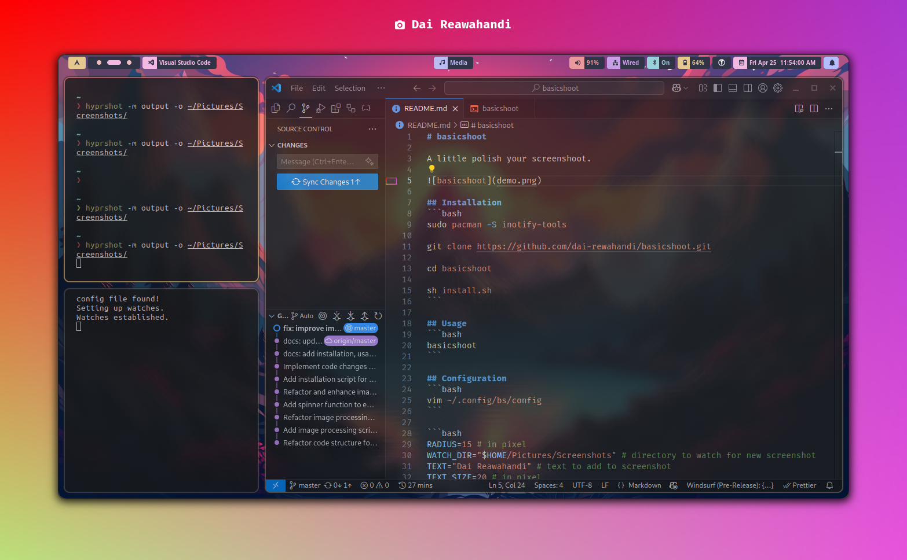
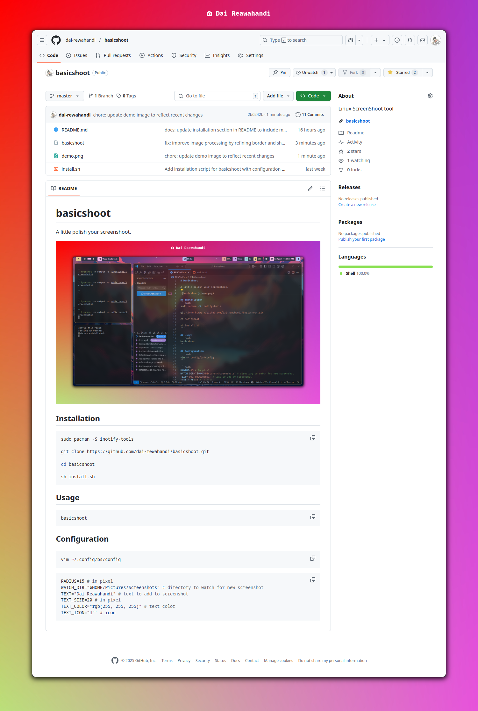

# 📸 bs — Beautiful Screenshots with Bash + ImageMagick
Basicshoot is a lightweight Bash-based tool that automatically watches your screenshot folder and beautifies every new image with stylish rounded corners, drop shadows, gradient background, and custom text — making your screenshots visually stunning with zero effort.

## ✨ Features
- 🔁 Auto Watcher: Monitors your screenshot folder in real-time using inotifywait.

- 🖼️ Rounded Corners & Border: Adds smooth rounded corners and a clean border.

- 🌫️ Shadows: Creates subtle drop shadows for depth.

- 🎨 Gradient Background: Generates a colorful, two-tone gradient background.

- ✍️ Custom Text & Icon: Adds your own text (e.g., name or signature) using Nerd Fonts.

- 📁 Auto Save: Processed images are moved into a good/ subfolder.

- ⚙️ Configurable: Everything is customizable via a simple config file at ~/.config/bs/config.

## 🧰 Requirements
1. bash
2. ImageMagick
3. inotify-tools
4. Font: FiraCode Nerd Font (optional but recommended)
---

[TERMUX VERSION (ANDROID)](https://github.com/dai-rewahandi/basicshoot/tree/termux)

A little polish your screenshoot.





## Installation
```bash
# skip if already installed
sudo pacman -S inotify-tools
sudo pacman -S imagemagick
# required font
# skip if already installed
sudo pacman -S ttf-firacode-nerd 

git clone https://github.com/dai-rewahandi/basicshoot.git

cd basicshoot

sh install.sh
```

## Uninstall
<3 [@ad1w](https://github.com/ad1w)
```bash
cd basicshoot
bash insatall.sh -R
```

## Usage
```bash 
1. Run => basicshoot
2. Take screenshot with app whatever you want
3. check your screenshot/good folder
```

## Configuration
```bash
vim ~/.config/bs/config
```

```bash
RADIUS=15 # in pixel
WATCH_DIR="$HOME/Pictures/Screenshots" # directory to watch for new screenshot
TEXT="Bs" # text to add to screenshot
TEXT_SIZE=20 # in pixel
TEXT_COLOR="rgb(255, 255, 255)" # text color
TEXT_ICON="󰄀"' # icon
```
